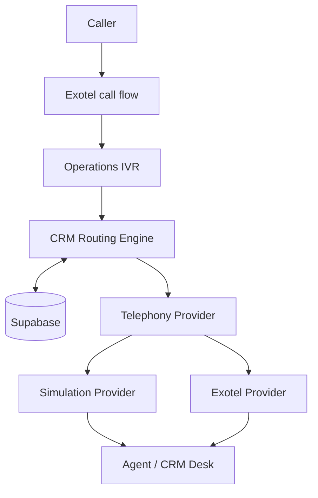
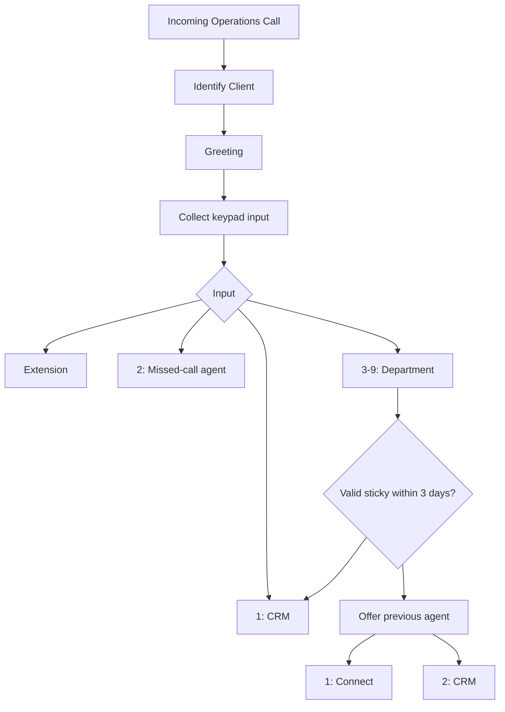
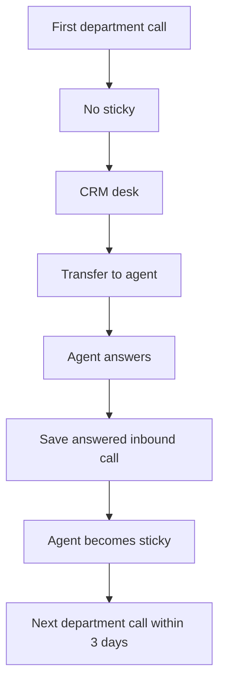
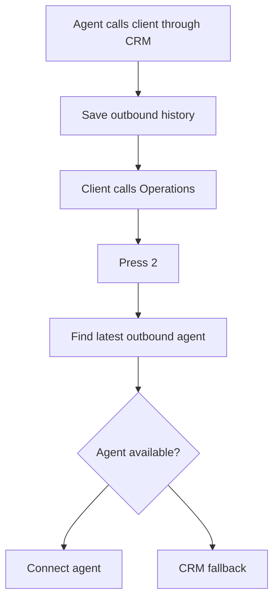

# Architecture

SKA TeleCRM is a Next.js 16 (App Router) application backed by Supabase. All call-routing decisions are made by the **CRM routing engine** (`src/lib/routing/routing.engine.ts`); the telephony provider only rings phones. The simulator and future Exotel webhooks call the **same** engine functions.

## Layers

| Layer | Location | Notes |
|---|---|---|
| UI (client components) | `src/app/(dashboard)/*`, `src/components/*` | Fetch JSON from `/api/*` via `useApi` |
| API routes | `src/app/api/*` | Zod validation → backend role check → service → uniform `{ok,data|error}` JSON |
| Services | `src/lib/services/*` | Client, team, call, reminder, report, audit, idempotency |
| Routing | `src/lib/routing/*` | Engine + sticky / missed-call / extension / department / fallback |
| Telephony | `src/lib/telephony/*` | `TelephonyProvider` interface; simulation + Exotel (click-to-call API, call-flow steps in `exotel.flow.ts`, webhook token) |
| Data | `src/lib/data/*` | `Store` interface: `SupabaseStore` (prod) or seeded `MemoryStore` (demo/tests) |
| Proxy | `src/proxy.ts` | Next 16 replacement for `middleware.ts`; session refresh + login redirect |

## Overall architecture

## Operations routing

## Sticky learning

## Missed-call routing

## Call session state machine

`greeting → (sticky_offer) → dialing → connected → ended`, with `voicemail` reachable from any failed fallback or after hours. Every engine function checks the current state and returns **409 invalid_state** otherwise, so out-of-order or replayed provider events cannot corrupt a call.

## Security

- **Auth**: Supabase Auth (email/password, sign-up disabled). Without Supabase env vars the app runs in **demo mode** with an HMAC-signed, httpOnly cookie.
- **Backend role checks**: every API route calls `requireUser(permission)`; matrix in `src/lib/constants` (`PERMISSIONS`).
- **RLS**: enabled on every table (`supabase/migrations/*_views_security.sql`). The server uses the service-role key only after the role check; browsers can only use the anon key under RLS.
- **Secrets**: service-role and Exotel keys are server-only env vars (never `NEXT_PUBLIC_`).
- **Validation**: Zod on every input, mirrored by SQL `check` constraints; phone numbers normalised to E.164.
- **Rate limiting**: per IP + route (`src/lib/utils/rate-limit.ts`).
- **Idempotency**: `webhook_events(provider, event_key)` unique claim before execution; replays return the stored result.
- **Audit**: `audit_logs` written for all mutations; admin-only read.
- **Recordings**: Exotel recording links are stored in `tc_recordings` (server-only table). Copying them to private Supabase Storage is a follow-up.
- **Exotel webhooks**: Exotel cannot sign requests, so every Exotel URL carries `?token=<TELEPHONY_WEBHOOK_SECRET>` (checked in constant time; never written to the event log).
- **Simulator on the live database**: simulated and real calls never influence each other's sticky / missed-call routing, and reports leave simulated calls out when telephony is live.
- **CSV**: formula-injection guard.
